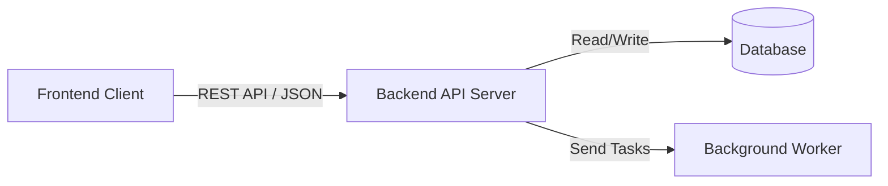

# Software Requirements Specification (SRS)

**Project Name:** [Insert Project Name]  
**Version:** 1.0.0  
**Status:** Draft / Review / Approved  
**Author(s):** [Insert Names/Team]  
**Last Updated:** [YYYY-MM-DD]  

---

## Table of Contents
1. [Introduction](#1-introduction)
   - [1.1 Purpose](#11-purpose)
   - [1.2 Scope](#12-scope)
   - [1.3 Definitions, Acronyms, and Abbreviations](#13-definitions-acronyms-and-abbreviations)
   - [1.4 References](#14-references)
   - [1.5 Overview](#15-overview)
2. [Overall Description](#2-overall-description)
   - [2.1 Product Perspective](#21-product-perspective)
   - [2.2 Product Functions](#22-product-functions)
   - [2.3 User Classes and Characteristics](#23-user-classes-and-characteristics)
   - [2.4 Operating Environment](#24-operating-environment)
   - [2.5 Design and Implementation Constraints](#25-design-and-implementation-constraints)
   - [2.6 Assumptions and Dependencies](#26-assumptions-and-dependencies)
3. [External Interface Requirements](#3-external-interface-requirements)
   - [3.1 User Interfaces](#31-user-interfaces)
   - [3.2 Hardware Interfaces](#32-hardware-interfaces)
   - [3.3 Software Interfaces](#33-software-interfaces)
   - [3.4 Communications Interfaces](#34-communications-interfaces)
4. [System Features (Functional Requirements)](#4-system-features-functional-requirements)
   - [4.1 Feature 1: [Name of Feature]](#41-feature-1-name-of-feature)
5. [Non-Functional Requirements](#5-non-functional-requirements)
   - [5.1 Performance Requirements](#51-performance-requirements)
   - [5.2 Safety Requirements](#52-safety-requirements)
   - [5.3 Security Requirements](#53-security-requirements)
   - [5.4 Software Quality Attributes](#54-software-quality-attributes)
6. [Other Requirements](#6-other-requirements)
7. [Appendices](#7-appendices)

---

## 1. Introduction

### 1.1 Purpose
> *Describe the purpose of this SRS document and who the intended audience is.*  
Example: This document specifies the functional and non-functional requirements for [Project Name]. It serves as the baseline for development, testing, and project scoping.

### 1.2 Scope
> *Identify the software product to be produced, what it will and will not do, and its main benefits/objectives.*  
* **In Scope:** [List core deliverables]
* **Out of Scope:** [List what is explicitly excluded in this version]

### 1.3 Definitions, Acronyms, and Abbreviations

| Term / Acronym | Definition |
| :--- | :--- |
| **SRS** | Software Requirements Specification |
| **API** | Application Programming Interface |
| **[Term]** | [Definition] |

### 1.4 References
* [IEEE Std 830-1998 / ISO/IEC/IEEE 29148](https://github.com/jam01/SRS-Template)
* [Link to related project docs, architecture diagrams, or wireframes]

### 1.5 Overview
> *Briefly state what the rest of the SRS document contains and how the document is structured.*

---

## 2. Overall Description

### 2.1 Product Perspective
> *Explain whether the product is a self-contained system, a component of a larger system, or a replacement for an existing software.*

### 2.2 Product Functions
> *Summarize the major functions the software will perform.*
* Function A: [e.g., User Authentication and RBAC]
* Function B: [e.g., Real-time data synchronization]

### 2.3 User Classes and Characteristics
> *Identify the various user groups who will use the system and their technical proficiency.*
1. **Admin / Operator:** Full system configuration rights, high technical proficiency.
2. **End User:** Standard feature access, general consumer level.

### 2.4 Operating Environment
> *Specify the hardware, OS, browser, or cloud environment where the software will run.*
* **Client OS:** iOS, Android, Windows, macOS, Linux (Browsers: Chrome, Firefox, Safari)
* **Server / Cloud:** AWS / Docker / Kubernetes / Node.js runtime

### 2.5 Design and Implementation Constraints
> *List any regulatory, language, database, or corporate policies constraining the design.*
* Must comply with GDPR / local data privacy laws.
* Must use PostgreSQL as the primary relational database.

### 2.6 Assumptions and Dependencies
> *List external factors, third-party libraries, or APIs the project depends on.*
* Assumption: Third-party payment gateway (Stripe) API remains stable.
* Dependency: OAuth2 provider (Google / GitHub login).

---

## 3. External Interface Requirements

### 3.1 User Interfaces
> *Describe graphical user interface (GUI) requirements, screen mockups, or design system references.*
* Screen layouts will follow the Figma design system link: `[Figma Link Here]`
* Responsive design required for mobile (375px+) and desktop (1280px+).

### 3.2 Hardware Interfaces
> *Describe logical and physical characteristics of any hardware the software interfaces with (or "None").*

### 3.3 Software Interfaces
> *Specify the use of databases, operating systems, libraries, or external REST/GraphQL APIs.*
* Integration with [Service X] via REST API v2.

### 3.4 Communications Interfaces
> *Specify communication protocols to be used.*
* HTTPS / TLS 1.3 for web traffic
* WSS (WebSocket Secure) for live notifications

---

## 4. System Features (Functional Requirements)

### 4.1 Feature 1: [Name of Feature, e.g., User Login]
* **Description:** [Brief description of what the feature does]
* **Stimulus / Use Case:** [Trigger event, e.g., User clicks "Sign In with GitHub"]
* **Functional Requirements:**
  * **REQ-4.1.1:** The system shall authenticate the user credentials against the OAuth provider.
  * **REQ-4.1.2:** The system shall redirect unauthenticated users to the login page.
  * **REQ-4.1.3:** The system shall lock the account after 5 consecutive failed login attempts.

---

## 5. Non-Functional Requirements

### 5.1 Performance Requirements
* **REQ-5.1.1:** API response times shall be under 200ms for 95% of standard read requests under normal load.
* **REQ-5.1.2:** The system shall support a minimum of [X] concurrent active users.

### 5.2 Safety Requirements
> *Describe requirements that prevent injury, data corruption, or physical harm (if applicable).*

### 5.3 Security Requirements
* **REQ-5.3.1:** All user passwords must be hashed using bcrypt or Argon2.
* **REQ-5.3.2:** Data at rest must be encrypted using AES-256.

### 5.4 Software Quality Attributes
* **Availability:** 99.9% uptime.
* **Maintainability:** Unit test coverage must exceed 80% prior to merge into `main`.

---

## 6. Other Requirements
* **Database Requirements:** Daily automated backups with a 30-day retention policy.
* **Internationalization (i18n):** Initial support for English (`en`), with architecture ready for multi-language translation.

---

## 7. Appendices

### Appendix A: Glossary
* **Term A:** Definition A.

### Appendix B: To Be Determined (TBD) List

| ID | Item | Action Owner | Target Date |
| :--- | :--- | :--- | :--- |
| TBD-1 | Finalize payment gateway provider | Product Manager | YYYY-MM-DD |


# Software Design Documentation (SDD)

**Project Name:** [Insert Project Name]  
**Version:** 1.0.0  
**Date:** YYYY-MM-DD  
**Author(s):** [Your Name / Team]  

---

## 1. System Overview & Goals

### 1.1 Summary
> A brief 2–3 sentence summary explaining what this software does, who uses it, and the problem it solves.

### 1.2 Design Goals
* **[Goal 1]:** (e.g., Simple, flat codebase easy for solo maintainers)
* **[Goal 2]:** (e.g., Fast load times under 200ms)
* **[Goal 3]:** (e.g., Offline-first functionality)

### 1.3 Constraints & Assumptions
* **Tech Stack Constraints:** Written strictly in [e.g., TypeScript / Python].
* **Database Constraints:** Must run locally on a single SQLite instance.
* **Assumptions:** Users have a reliable broadband internet connection for initial setup.

---

## 2. Architectural Design

### 2.1 High-Level Architecture
> Describe how components talk to each other. You can use GitHub's native Mermaid syntax to draw a quick diagram:



### 2.2 Component Breakdown
* **Client / Frontend:** Renders UI, manages user state, and interacts with the API.
* **Server / Backend:** Processes business logic, validates data inputs, and enforces authorization rules.
* **Database:** System of record for storing system resources.

---

## 3. Data & Storage Design

### 3.1 Database Schema
> Define your database tables or collection structures using Markdown tables.

#### Table: `users`

| Column Name | Data Type | Constraints | Description |
| :--- | :--- | :--- | :--- |
| `id` | INTEGER | PRIMARY KEY, AUTOINCREMENT | Unique record ID |
| `username` | VARCHAR(50) | UNIQUE, NOT NULL | Account handle |
| `created_at` | DATETIME | DEFAULT current_timestamp | Account timestamp |

#### Table: `items`

| Column Name | Data Type | Constraints | Description |
| :--- | :--- | :--- | :--- |
| `id` | INTEGER | PRIMARY KEY | Unique item ID |
| `user_id` | INTEGER | FOREIGN KEY -> users(id) | Associated owner |
| `title` | TEXT | NOT NULL | Item name |

---

## 4. API & Interface Design

### 4.1 Authentication Approach
> Explain how access is handled (e.g., Stateless HTTP-only session cookies, JWT in Authorization header).

### 4.2 Key Endpoints

#### `GET /api/items`
* **Description:** Retrieves all items owned by the authenticated user.
* **Response (200 OK):**
  ```json
  [
    {
      "id": 101,
      "title": "Example Item Name",
      "user_id": 1
    }
  ]
  ```

#### `POST /api/items`
* **Description:** Creates a new item record.
* **Request Body:**
  ```json
  {
    "title": "New Item Name"
  }
  ```
* **Response (201 Created):**
  ```json
  {
    "id": 102,
    "title": "New Item Name",
    "user_id": 1
  }
  ```

---

## 5. Security & Resiliency

* **Authentication & Permissions:** Only resource owners can edit or delete their data records.
* **Data Validations:** Inputs are sanitized on the server side using validation schemas before processing queries.
* **Error Handling:** Standardized error codes are returned to the client application (`400 Bad Request`, `401 Unauthorized`, `404 Not Found`, `500 Server Error`).

---

## 6. Infrastructure & Deployment

* **Development Environment:** Spin up local testing setups using `docker-compose up` or simple startup scripts (`npm run dev`).
* **Deployment Pipeline:** Merging code changes to the `main` branch automatically triggers unit tests and builds the application via [e.g., GitHub Actions].
* **Production Hosting:** The application runs deployed on [e.g., a simple VPS / Render / Vercel].

# Software Coding Documentation & Guidelines

**Project Name:** [Insert Project Name]  
**Version:** 1.0.0  
**Target Environment:** [e.g., Node.js v20+, Python 3.11+, Java 21]  
**Last Updated:** YYYY-MM-DD  

---

## 1. Getting Started

### 1.1 Development Environment Setup
> Step-by-step instructions to get a developer's local machine ready to write code.

1. **Clone the repository:**
   ```bash
   git clone https://github.com
   cd project-name
   ```
2. **Install dependencies:**
   ```bash
   # Replace with your stack's command (e.g., npm install, pip install -r requirements.txt)
   npm install
   ```
3. **Configure environment variables:**
   * Copy `.env.example` to `.env`
   * Populate required secrets (database credentials, API keys) local to your machine.

### 1.2 Running the Application Setup
* **Start local development server:** `npm run dev` (or equivalent tool).
* **Local access URL:** Defaults to `http://localhost:3000`.

---

## 2. Directory & Project Structure

> A map explaining where specific logic lives so developers know exactly where to create new files.

# Software Testing Documentation

**Project Name:** [Insert Project Name]  
**Version/Release:** v1.0.0  
**Date:** YYYY-MM-DD  
**QA Contact/Lead:** [Your Name / Team Name]  

---

## 1. Testing Strategy & Scope

### 1.1 Objective
> State the primary goal of the testing lifecycle for this software release.
Example: To verify that all core workflows (Authentication, Checkout, and Notification pipelines) behave according to requirements, perform reliably, and contain no blocking functional defects.

### 1.2 Testing Types in Scope
* **Unit Testing:** Validating isolated helper functions, mathematical operations, and utility hooks.
* **Integration Testing:** Ensuring the backend API endpoints securely read and write data to the database instance.
* **End-to-End (E2E) Testing:** Simulating complete user workflows (browser automation) from login to order generation.
* **Regression Testing:** Verifying that new code commits do not break existing, stable software features.

### 1.3 Out of Scope
* **Performance/Load Testing:** High-volume traffic simulation is deferred until a later release phase.
* **Accessibility (a11y) Testing:** Deep compliance auditing is currently handled via best-effort development tools.

---

## 2. Test Environment & Automation Tools

### 2.1 Test Environment Setup
* **Staging Server URL:** `https://example.com`
* **Test Database:** Clean, seeded database populated with mock users and product listings via `npm run db:seed`.

### 2.2 Testing Stack
* **Unit & Integration runner:** [e.g., Jest / PyTest / Vitest]
* **End-to-End browser framework:** [e.g., Playwright / Cypress]
* **CI/CD Integration:** Automated test execution runs on every pull request via [e.g., GitHub Actions].

---

## 3. Test Cases (Matrix)

> Define the criteria used to verify individual capabilities.

### 3.1 Functional Test Suites

#### Module A: Authentication (`/auth`)

| Test ID | Scenario Description | Expected Result | Status |
| :--- | :--- | :--- | :--- |
| **TC-AUTH-01** | Login with valid credentials | User receives 200 OK and valid JWT token. | Passed |
| **TC-AUTH-02** | Login with wrong password | Server rejects request with 401 Unauthorized. | Passed |
| **TC-AUTH-03** | Attempt login with empty fields | Input validation blocks submission with 400 Bad Request. | Passed |

#### Module B: Order Placement (`/orders`)

| Test ID | Scenario Description | Expected Result | Status |
| :--- | :--- | :--- | :--- |
| **TC-ORD-01** | Create an order with items in stock | Order created with status `pending`, stock count decrements. | Passed |
| **TC-ORD-02** | Create an order with out-of-stock item | System prevents order checkout, returns error payload. | Failed |

---

## 4. Defect Log (Bug Tracking)

> Document issues found during manual or automated testing that require engineering attention.

| Bug ID | Summary / Description | Severity | Assigned To | Status |
| :--- | :--- | :--- | :--- | :--- |
| **BUG-001** | Out-of-stock item can still be added to cart. | High | @developer_name | Open |
| **BUG-002** | User profile image fails to upload on mobile screens. | Medium | @frontend_eng | Resolved |

---

## 5. Execution Summary & Sign-off

### 5.1 Test Results Overview
* **Total Test Cases Executed:** 42
* **Passed:** 40 (95.2%)
* **Failed:** 2 (4.8%)
* **Blocked:** 0

### 5.2 Criteria for Release (Exit Criteria)
* [x] 100% of critical paths passed successfully.
* [x] Zero unresolved "High" or "Critical" severity bugs remaining in the log.
* [ ] Code test coverage reports hit a minimum baseline of **80%**.

### 5.3 Quality Assurance Sign-Off
* **Status:** [PENDING / APPROVED]
* **Signed by:** _______________________  **Date:** YYYY-MM-DD


